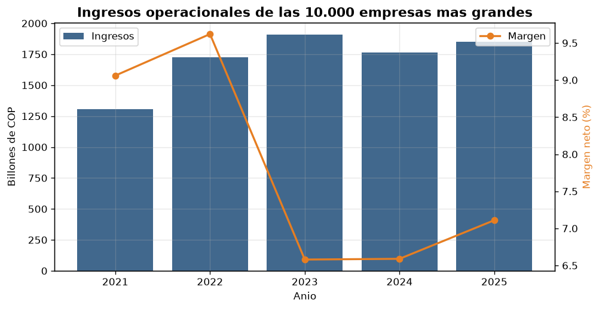
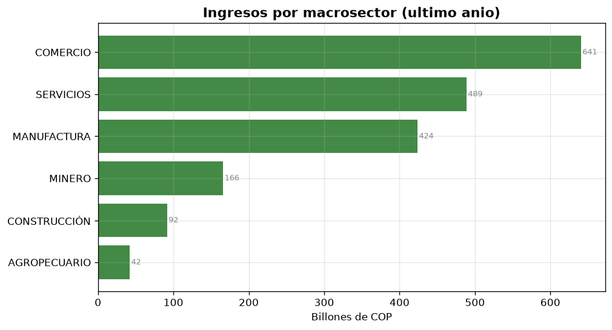
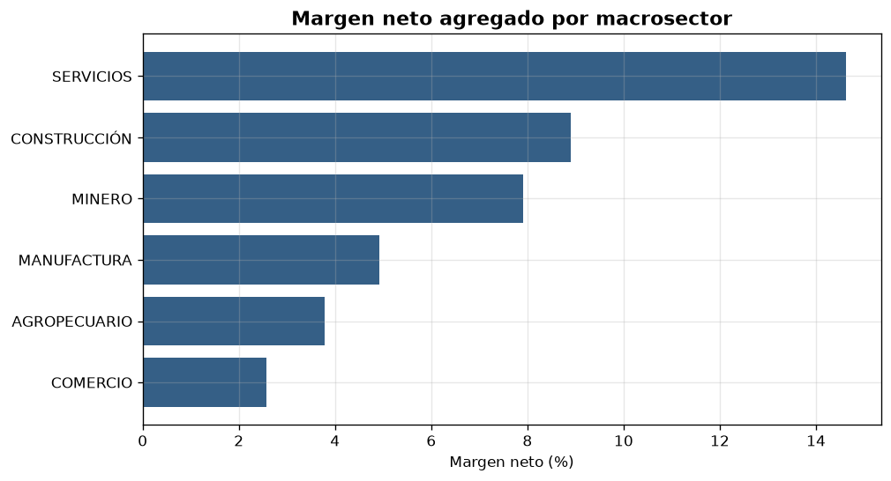
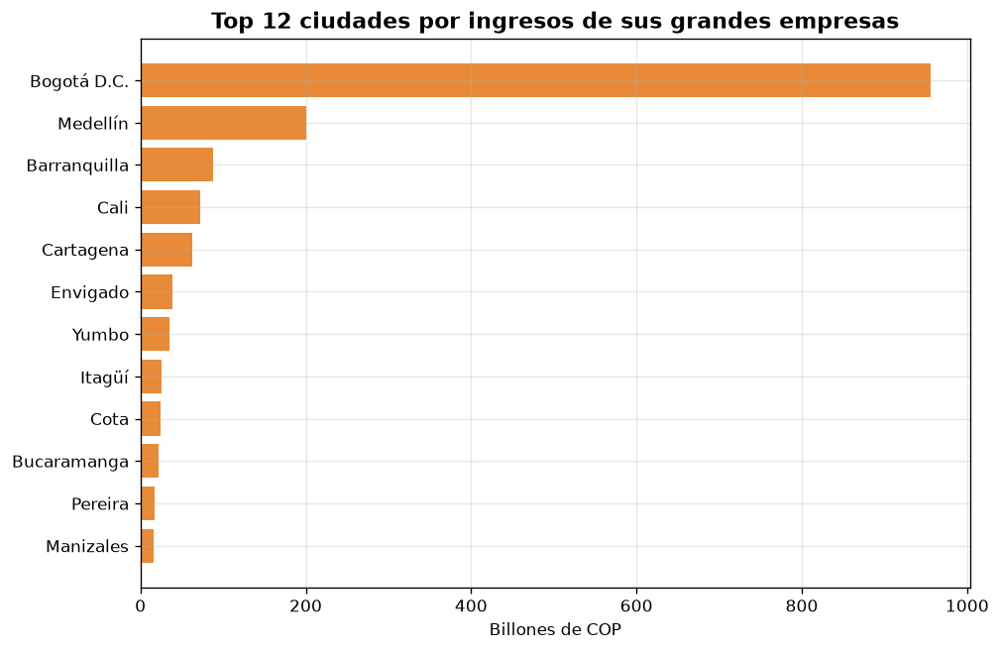
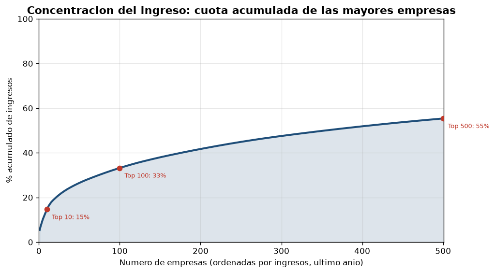
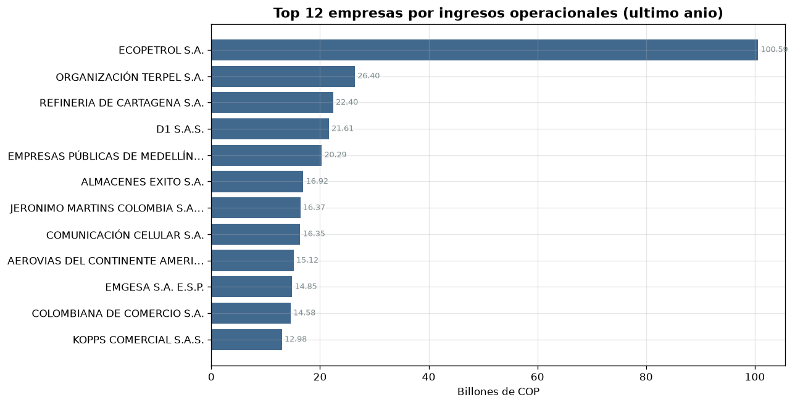
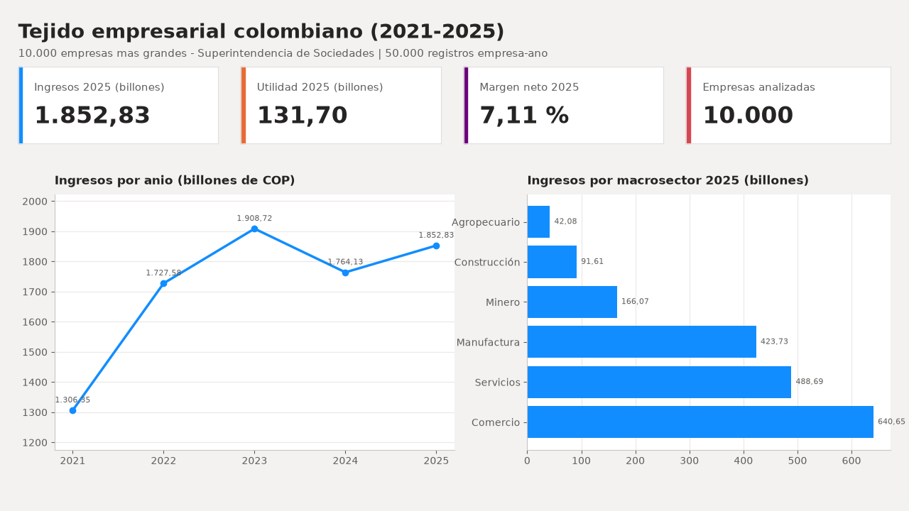
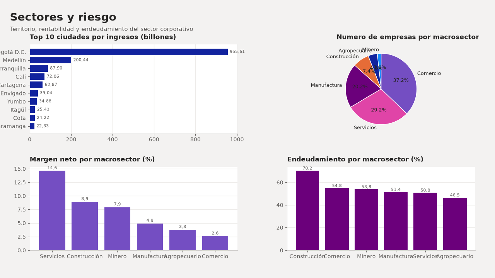

# Tejido Empresarial Colombiano — Analítica end-to-end (SQL + Python + Power BI)

> Proyecto de portafolio que integra **SQL, Python y Power BI** sobre datos
> abiertos reales de la **Superintendencia de Sociedades** para responder una
> pregunta de negocio: **¿cómo se distribuye el ingreso, la rentabilidad y el
> riesgo del tejido empresarial colombiano?**


---

## Abstract (English)

End-to-end analytics portfolio project combining **SQL, Python and Power BI** on
**50,000 company-year records** — the *10,000 largest companies in Colombia*
(2021–2025, Superintendencia de Sociedades open data). It builds a reproducible
pipeline (download → ETL → star schema → KPIs → dashboard) and delivers a
sector/region view of revenue, profitability (margin, ROA, ROE), leverage,
loss-making companies and **market concentration (Pareto)**. Reproducible with
`python src/run_all.py`.

---

## 1. Problema de negocio

**Persona:** analista de riesgos / consultoría económica / observatorio
empresarial que necesita caracterizar el sector corporativo colombiano.

**Pregunta:** el desempeño del tejido empresarial no es homogéneo. ¿Qué sectores
y regiones concentran el ingreso? ¿Dónde está la rentabilidad y dónde el riesgo
de sobreendeudamiento? ¿Está el ingreso muy concentrado en pocas empresas?

**Objetivo:** construir un pipeline reproducible (dato crudo → modelo analítico →
KPIs → tablero) que permita:

1. Medir la evolución anual (2021–2025) de ingresos y utilidades del segmento de
   mayores empresas.
2. Caracterizar la **estructura sectorial y regional** del ingreso.
3. Comparar **rentabilidad** (margen, ROA, ROE), **endeudamiento** y **pérdidas**
   por sector.
4. Cuantificar la **concentración del mercado** (curva de Pareto).
5. Rankear empresas por tamaño, rentabilidad y **crecimiento**.

## 2. Datos (datos abiertos de Colombia)

| Dataset | Entidad | Periodo | Registros | Licencia | Enlace |
|---|---|---|---|---|---|
| 10.000 Empresas más Grandes del País | Superintendencia de Sociedades | 2021–2025 | 50.000 (empresa-año) | CC-BY-SA-4.0 | [portal](https://www.datos.gov.co/Comercio-Industria-y-Turismo/10-000-Empresas-mas-Grandes-del-Pa-s/6cat-2gcs) |

50.000 registros equivalen a **10.000 empresas por año × 5 años** y **15.032 NIT
distintos** (el top-10.000 **rota** cada año: unas empresas entran y otras salen).
Todas las cifras monetarias están en **billones de pesos (COP)**.

Los datos **no se versionan**: el pipeline los descarga automáticamente desde el
portal. Ver el [diccionario de datos](docs/diccionario_datos.md).

## 3. Arquitectura de la solución

```
                    +-------------------+
                    |  Datos abiertos   |
                    |    Colombia       |
                    |  (Supersociedades)|
                    +---------+---------+
                              |  requests (descarga)
                              v
   data/raw/......   +-------------------+
   empresas.csv       |  download_data.py |
                      +---------+---------+
                              |
                              v
                    +-------------------+      MODELO ESTRELLA
                    |      etl.py       |--->  fact_financiero
                    |  limpieza + dims  |      dim_empresa / dim_sector
                    +---------+---------+      dim_geografia / dim_anio
                              |
                              v
                    +-------------------+      data/warehouse.db (SQLite)
                    |   warehouse.db    |----> data/processed/*.csv
                    +---------+---------+
                              |  SQL (sql/02_kpi_queries.sql)
                              v
                    +-------------------+      reports/figures/*.png
                    |   analytics.py    |----> data/processed/kpi_*.csv
                    +---------+---------+
                              |
                              v
                    +-------------------+
                    |     Power BI      |  tablero ejecutivo (PBIP + DAX)
                    +-------------------+
```

**Stack:** SQL (modelo estrella + consultas analíticas) · Python (ETL, KPIs y
visualización) · Power BI (tablero interactivo y modelo de datos).

## 4. Resultados clave (2021–2025)

### 4.1 Evolución del segmento de mayores empresas

| Año | Empresas | Ingresos (billones) | Utilidad neta | Margen |
|---|---|---|---|---|
| 2021 | 10.000 | 1.306,35 | 118,35 | 9,06 % |
| 2022 | 10.000 | 1.727,58 | 166,21 | 9,62 % |
| 2023 | 10.000 | 1.908,72 | 125,66 | 6,58 % |
| 2024 | 10.000 | 1.764,13 | 116,18 | 6,59 % |
| **2025** | **10.000** | **1.852,83** | **131,70** | **7,11 %** |

Los ingresos crecieron hasta un máximo en **2023** (1.908,72 billones); en 2024
retrocedieron y en 2025 se recuperaron parcialmente. El **margen neto se comprimió**
de 9,6 % (2022) a ~7 % (2024–2025).



### 4.2 Estructura sectorial (2025)

| Macrosector | Empresas | Ingresos (billones) | Margen | Endeudamiento |
|---|---|---|---|---|
| Comercio | 3.718 | 640,65 | 2,58 % | 54,8 % |
| Servicios | 2.925 | 488,69 | **14,62 %** | 50,8 % |
| Manufactura | 2.016 | 423,73 | 4,92 % | 51,4 % |
| Minero | 177 | 166,07 | 7,92 % | 53,8 % |
| Construcción | 745 | 91,61 | 8,91 % | **70,2 %** |
| Agropecuario | 419 | 42,08 | 3,78 % | 46,5 % |

**Comercio** aporta el mayor ingreso, pero **Servicios** es el más rentable
(14,6 %). **Construcción** presenta el mayor **endeudamiento** (70,2 %).




### 4.3 Territorio: la concentración en Bogotá

**Bogotá D.C.** concentra 4.002 empresas y **955,61 billones** (≈ 52 % del
ingreso total), seguida por **Medellín (200,44)**, **Barranquilla (87,90)**,
**Cali (72,06)** y **Cartagena (62,87)**. Por región, **Bogotá–Cundinamarca**
(1.045,92) y **Antioquia** (318,65) explican la mayor parte.



### 4.4 Concentración del mercado (Pareto)

El ingreso está **muy concentrado**:

| Corte | % del ingreso total |
|---|---|
| Top 10 empresas | 14,6 % |
| Top 100 empresas | 33,2 % |
| Top 500 empresas | 55,4 % |

Solo **13 empresas "gigantes"** (≥ $10 billones) generan el **16,7 %** del
ingreso; las 271 empresas con ingresos ≥ $1 billón concentran el **46 %**.



### 4.5 Rentabilidad, pérdidas y crecimiento

- **Líderes por ingreso (2025):** Ecopetrol (100,59), Terpel (26,40), Refinería de
  Cartagena (22,40), D1 (21,61) y EPM (20,29).
- **Empresas en pérdida:** ~4–5 % cada año (417 empresas, 25,86 billones de
  pérdidas en 2024).
- **Mayor crecimiento 2021→2025:** Avianca (+244 %), Emgesa (+214 %) y Jerónimo
  Martins (+207 %) — recuperación post-pandemia y expansión del descuento.



El análisis completo de hallazgos y recomendaciones está en
[`docs/informe.md`](docs/informe.md).

## 5. Tablero de Power BI

Entregado como **proyecto PBIP** (formato de texto versionable en Git), listo
para abrir en Power BI Desktop:

```
powerbi/TejidoEmpresarial/TejidoEmpresarial.pbip
```

Incluye el modelo estrella, 6 medidas DAX y dos páginas (Panorama general y
Sectores y riesgo). Instrucciones en
[`powerbi/TejidoEmpresarial/README.md`](powerbi/TejidoEmpresarial/README.md).

**Página 1 — Panorama general**



**Página 2 — Sectores y riesgo**



## 6. Cómo ejecutar

```bash
pip install -r requirements.txt
python src/run_all.py
```

Pasos individuales:

```bash
python src/download_data.py   # 1. descarga a data/raw
python src/etl.py             # 2. construye data/warehouse.db + data/processed
python src/analytics.py       # 3. genera KPIs (CSV) y figuras (PNG)
```

## 7. Estructura del repositorio

```
tejido-empresarial-colombia/
├── src/
│   ├── config.py          # rutas, fuentes y catálogos de normalización
│   ├── download_data.py   # descarga el CSV del portal (API Socrata)
│   ├── etl.py             # limpieza y modelo estrella -> SQLite
│   ├── analytics.py       # ejecuta el SQL, genera KPIs y figuras
│   └── run_all.py         # ejecuta todo el pipeline
├── sql/
│   ├── 01_schema.sql      # DDL del modelo estrella
│   └── 02_kpi_queries.sql # consultas analíticas (KPIs)
├── powerbi/
│   ├── TejidoEmpresarial/     # proyecto PBIP (modelo + tablero)
│   ├── guia_tablero.md        # construcción manual del tablero
│   └── medidas_dax.md         # medidas DAX
├── docs/
│   ├── informe.md             # informe de hallazgos de negocio
│   ├── diccionario_datos.md   # definición de tablas y campos
│   └── img/                   # capturas y vistas previas
├── data/                  # (generado) raw/, processed/, warehouse.db
├── reports/figures/       # (generado) gráficas del análisis
└── requirements.txt
```

## 8. Habilidades demostradas

- **ETL y calidad de datos:** ingesta vía API Socrata, conversión de cifras en
  texto (`"$ 100.59"`, `"-$ 0.82"`) a numérico, normalización de CIIU (4 dígitos),
  municipios y regiones; **detección de re-etiquetado de categorías entre años**.
- **Modelado de datos:** esquema en estrella con claves subrogadas y dimensiones
  de empresa, sector, geografía y año.
- **SQL analítico:** DDL, índices, agregaciones, ratios (margen, ROA, ROE,
  endeudamiento) y **funciones de ventana** para la curva de Pareto.
- **DAX / Power BI:** medidas, relaciones y tablero con proyecto PBIP.
- **Análisis de negocio:** KPIs, concentración de mercado, segmentación por tamaño
  y recomendaciones accionables.
- **Reproducibilidad:** pipeline de un comando, requisitos fijados y
  documentación.

## 9. Autor

**Juan Rojas** — GitHub: [@jdrojasp11](https://github.com/jdrojasp11)

> ¿Buscando talento en analítica de datos? Este repositorio demuestra un flujo
> completo de datos: de la fuente cruda al insight de negocio.

## 10. Licencia y atribución

Datos publicados por la **Superintendencia de Sociedades** bajo licencia
**CC-BY-SA-4.0**. El código de este repositorio se distribuye bajo licencia
**MIT** (ver [`LICENSE`](LICENSE)).
